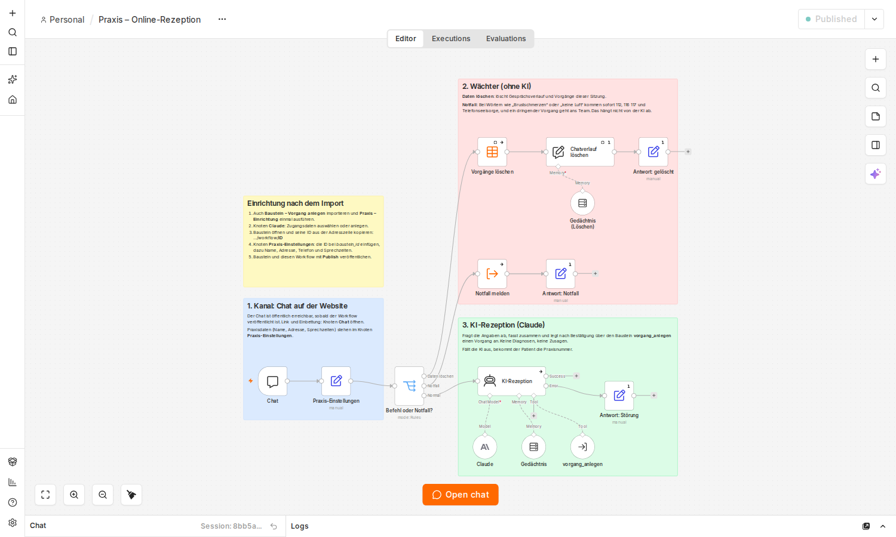
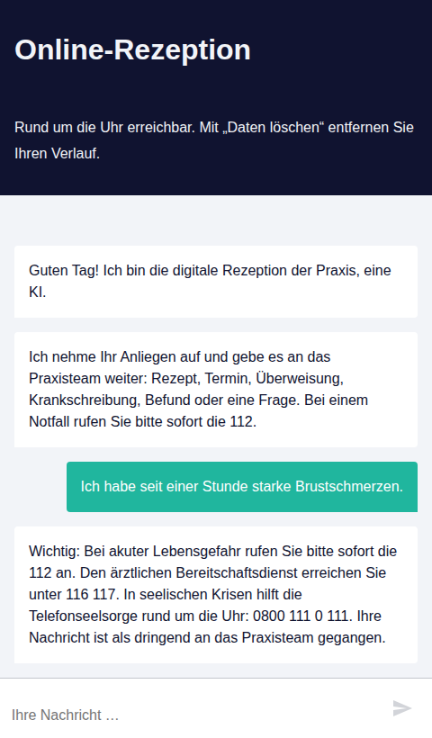

# n8n: Online-Rezeption für die Arztpraxis

Das Praxis-Layout nach dem Vorbild von 321 MED, gebaut als n8n-Workflows.
Patientinnen und Patienten schreiben im Chat. Die KI-Rezeption fragt die nötigen Angaben ab.
Das Praxisteam bekommt einen **fertig vorbereiteten Vorgang** statt einer rohen Nachricht.



## Aufbau

```
Kanal          Chat auf der Website       später: WhatsApp, Telefon, Jarvis
   │
Wächter        Notfall und „Daten löschen“, fest programmiert, ohne KI
   │
KI-Rezeption   Claude fragt die Angaben ab, fasst zusammen und holt die Bestätigung
   │
Baustein       Vorgang anlegen: prüfen, speichern, Team informieren
   │
Team           E-Mail pro Vorgang, werktags um 7:30 eine Übersicht, Tabelle „Vorgaenge“
```

| Datei | Workflow in n8n | Aufgabe |
| --- | --- | --- |
| `00-praxis-einrichtung.json` | Praxis – Einrichtung (einmal ausführen) | legt die Tabelle `Vorgaenge` an |
| `01-praxis-online-rezeption.json` | Praxis – Online-Rezeption | Chat, Wächter, KI-Rezeption |
| `02-baustein-vorgang-anlegen.json` | Baustein – Vorgang anlegen | prüft die Angaben, speichert den Vorgang, schickt die Team-Mail |
| `03-praxis-taeglich.json` | Praxis – Täglich: Übersicht und Löschfrist | werktags 7:30 E-Mail mit den offenen Vorgängen, löscht alte Vorgänge |

Die KI kümmert sich um diese Anliegen: Rezept, Termin, Überweisung, Krankschreibung, Befund, Frage.
Sie stellt keine Diagnosen und bewertet keine Beschwerden.

## Voraussetzungen

- n8n 2.x, selbst gehostet oder n8n Cloud (getestet mit 2.41.4). Für den Chat muss n8n über HTTPS aus dem Internet erreichbar sein.
- API-Schlüssel für Claude von [console.anthropic.com](https://console.anthropic.com).
- SMTP-Zugang für die E-Mails, zum Beispiel vom E-Mail-Postfach der Praxis.

## Einrichtung im Browser

1. **Importieren.** In n8n einen neuen Workflow anlegen, oben auf **⋯ → Import → From file** klicken, die Datei wählen und mit Strg+S speichern.
   Das für alle vier Dateien wiederholen, jede in einen eigenen neuen Workflow.
2. **Tabelle anlegen.** Den Workflow „Praxis – Einrichtung“ öffnen und auf **Execute workflow** klicken.
   Die Tabelle erscheint unter **Overview → Data tables → Vorgaenge**.
3. **Zugangsdaten.**
   - Online-Rezeption, Knoten **Claude**: bei *Credential* einen neuen Zugang mit dem API-Schlüssel anlegen.
   - Baustein, Knoten **Team benachrichtigen**, und Täglich, Knoten **Übersicht senden**: SMTP-Zugang anlegen bzw. auswählen.
4. **Baustein-ID eintragen.** Den Baustein öffnen und die ID aus der Adresszeile kopieren:
   `…/workflow/AbCdEf123456` → `AbCdEf123456`. Dann in der Online-Rezeption den Knoten **Praxis-Einstellungen** öffnen
   und die ID bei `baustein_id` einfügen.
   Den Baustein bitte nicht direkt in den Knoten *vorgang_anlegen* oder *Notfall melden* auswählen: n8n löscht dabei die vorbereitete Feldzuordnung.
5. **Praxisdaten eintragen.**
   - Online-Rezeption, **Praxis-Einstellungen**: Name, Adresse, Telefon, Sprechzeiten, weitere Infos.
   - Baustein und Täglich, jeweils Knoten **Einstellungen**: `team_email` (Postfach des Teams) und `absender_email`.
     Im Täglich-Workflow steht dort auch die Löschfrist `loeschfrist_tage` (Standard 30).
6. **Veröffentlichen.** Den Baustein, die Online-Rezeption und den Täglich-Workflow jeweils oben rechts mit **Publish** veröffentlichen.
   Der Chat nutzt immer die veröffentlichte Fassung des Bausteins. Ohne sie meldet n8n „Workflow is not active“.
   Nach jeder Änderung am Baustein also erneut veröffentlichen.
7. **Testen.** In der Online-Rezeption unten auf **Open chat** klicken und zum Beispiel schreiben:
   „Ich brauche ein Folgerezept“, dann den Anweisungen folgen. „Daten löschen“ und ein Satz mit „Brustschmerzen“ testen die Wächter.

Dieselben Schritte stehen als gelber Zettel auch direkt im Workflow „Praxis – Online-Rezeption“.

## Chat auf der Website

Den Knoten **Chat** öffnen. Dort steht die Adresse des Chats (`https://…/webhook/…/chat`).

- **Als Link:** Auf der Praxis-Website einen Knopf „Online-Rezeption“ mit dieser Adresse anlegen.
- **Eingebettet:** Mit dem Paket [`@n8n/chat`](https://www.npmjs.com/package/@n8n/chat) direkt in die Website einbauen.
  Dann im Knoten **Chat** bei *Allowed Origins (CORS)* statt `*` die Adresse der Website eintragen.



## Im Praxisalltag

- Jeder neue Vorgang kommt als E-Mail, zum Beispiel „Neuer Vorgang V-20260930-2IF7: Rezept“, bei Notfällen mit „[DRINGEND]“.
  Die E-Mail enthält keine Patientendaten.
- Die Angaben stehen in n8n unter **Overview → Data tables → Vorgaenge**.
- Erledigte Vorgänge dort auf `status` = `erledigt` setzen. Dann tauchen sie in der Übersicht nicht mehr auf.
- Werktags um 7:30 kommt eine E-Mail mit allen offenen Vorgängen, dringende zuerst. Ist nichts offen, kommt keine E-Mail.
- Nach 30 Tagen werden Vorgänge gelöscht, egal ob erledigt oder nicht.
  Was aufbewahrt werden muss, gehört ins Praxisverwaltungssystem.

## Datenschutz: was schon eingebaut ist

- Die Begrüßung sagt, dass eine KI antwortet (AI Act Art. 50).
- Der Notfall-Wächter reagiert auf Wörter wie „Brustschmerzen“, „Atemnot“ oder „Suizid“. Er nennt sofort 112, 116 117 und die Telefonseelsorge
  und meldet einen dringenden Vorgang. Das hängt nicht von der KI ab.
  Schlägt das Speichern fehl, nennt die Antwort zusätzlich die Telefonnummer der Praxis.
- „Daten löschen“ entfernt den Gesprächsverlauf und alle Vorgänge der Sitzung.
- Der Gesprächsverlauf liegt nur im Arbeitsspeicher von n8n (die letzten 20 Nachrichtenwechsel) und ist nach einem Neustart weg.
- Team-Mails enthalten keine Patientendaten, nur Vorgangsnummer, Anliegen und Dringlichkeit.
- Erfolgreiche Läufe speichert n8n nicht. Fehlgeschlagene Läufe bleiben für die Fehlersuche gespeichert,
  bis n8n sie automatisch löscht (Einstellung `EXECUTIONS_DATA_MAX_AGE`).
- Nur Workflows desselben Kontos dürfen den Baustein aufrufen.

**Vor dem Echtbetrieb mit Patientendaten** sind noch nötig:

1. Claude über eine EU-Region anbinden, also in n8n den Knoten **Claude** durch **AWS Bedrock Chat Model** (Region Frankfurt, `eu-central-1`)
   oder Google Vertex AI in einer EU-Region ersetzen. Die direkte Anthropic-API ist für Tests gedacht.
2. n8n in Deutschland hosten. Verträge zur Auftragsverarbeitung mit Hosting, KI-Anbieter und E-Mail-Anbieter abschließen,
   dazu eine Datenschutz-Folgenabschätzung und die Verschwiegenheit nach § 203 StGB.
3. § 393 SGB V klären: Cloud-Dienste für Gesundheitsdaten brauchen ein C5-Testat.
4. Das gehostete Chatfenster von n8n lädt seine Oberfläche von `cdn.jsdelivr.net`. Für den Echtbetrieb den Chat besser einbetten
   und die Dateien von `@n8n/chat` selbst ausliefern.

## Anpassen und erweitern

- **Anliegen und Ton:** im Knoten **KI-Rezeption** unter *System Message*. Die Pflichtangaben prüft der Knoten **Prüfen** im Baustein.
- **Modell:** Eingestellt ist Claude Opus 5.5. Für geringere Kosten im Knoten **Claude** Claude Sonnet 5.5 wählen.
- **Neue Kanäle** wie WhatsApp, Telefon oder Jarvis rufen denselben Baustein über den Knoten *Execute Workflow* auf.
  So landen alle Anfragen im selben Postfach und in derselben Tabelle.

| Eingabe des Bausteins | Bedeutung |
| --- | --- |
| `anliegen` | Rezept, Termin, Überweisung, Krankschreibung, Befund, Frage oder Notfall |
| `name`, `geburtsdatum`, `telefon` | Pflicht, außer bei Notfall; Geburtsdatum als TT.MM.JJJJ |
| `details`, `zusammenfassung` | Stichpunkte und Zusammenfassung für das Team |
| `dringend` | `true` bei Notfällen |
| `sessionId`, `kanal` | Sitzung für „Daten löschen“ und Herkunft, zum Beispiel `chat` oder `whatsapp` |

Antwort des Bausteins: `ok`, `vorgangsnummer` und `nachricht`, oder `ok: false` mit `fehler` (welche Angabe fehlt).

## Getestet

In n8n 2.41.4 mit Chromium:

- Import aller vier Dateien über **Import → From file** in eine leere Installation, dann die Schritte oben.
- Vorgang anlegen mit Team-Mail. Ein ungültiges Geburtsdatum (31.02.) wird abgelehnt und die KI bekommt den Hinweis.
- Notfall-Antwort und dringender Vorgang. Die Antwort kommt auch dann, wenn das Speichern scheitert.
- „Daten löschen“ entfernt die Vorgänge und den Gesprächsverlauf.
- Tagesübersicht per E-Mail und Löschfrist: ein alter Vorgang wurde gelöscht, neue blieben.

Claude selbst war im Test durch einen nachgebauten Server ersetzt. Mit echtem API-Schlüssel bitte einmal
ein paar Gespräche durchspielen, bevor der Chat auf die Website kommt.
